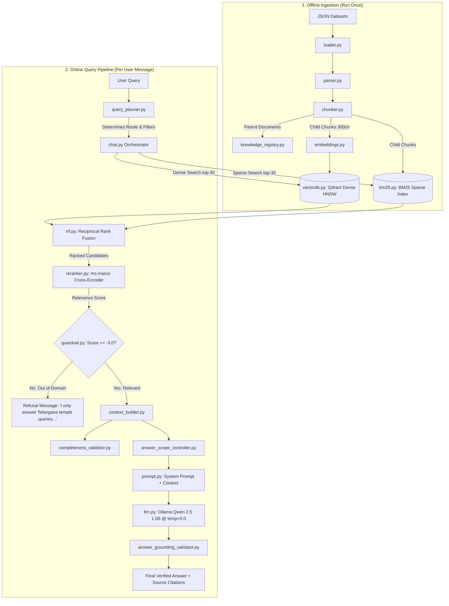

# 📖 PilgrimAI — Complete RAG Architecture & Codebase Study Guide

> **Purpose**: This document is a comprehensive study and preparation guide for the **PilgrimAI Retrieval-Augmented Generation (RAG)** engine. It breaks down every single code file, pipeline stage, design decision, and key code snippet in plain English.

---

## 🏛️ 1. Big Picture Architecture

PilgrimAI uses a **Local, Zero-Hallucination, Multi-Route Hybrid RAG Pipeline** specifically tailored for domain knowledge on Telangana Temples.



---

## 🧭 2. The 5 Retrieval Routes

The system uses `query_planner.py` to classify every query into one of five specialized routes:

| Route Name | When It Triggers | Retrieval Strategy | Example Query |
|---|---|---|---|
| **`TARGETED`** | Single Temple + Single Topic | Hybrid Vector + BM25 filtered by temple | *"What are the VIP darshan timings at Yadagirigutta?"* |
| **`COMPLETE_CATEGORY`** | Exact direct file match | $O(1)$ Direct Memory Registry lookup | *"Dress code for Bhadrachalam"* |
| **`CROSS_TEMPLE`** | Mentions 2+ temples or comparison | Multi-temple parallel retrieval & merge | *"Compare accommodation between Vemulawada and Yadagirigutta"* |
| **`MULTI_CATEGORY`** | Single temple + 2+ questions | Multi-category context slicing | *"Tell me timings, entry fees, and parking for Ramappa"* |
| **`BROAD_TEMPLE`** | General overview of a temple | Priority ordering: History $\to$ Deity $\to$ Timings $\to$ Festivals | *"Tell me about Thousand Pillar Temple"* |

---

## 📂 3. Complete File-by-File Code Breakdown

Here is every file in `backend/app/rag/`, its exact purpose, key code lines, and plain English explanation.

---

### 1. `config.py` — Central RAG Settings & Hyperparameters
* **Purpose**: Single source of truth for all paths, model identifiers, chunk sizes, and similarity thresholds.
* **Key Lines**:
  ```python
  EMBEDDING_MODEL_NAME: str = "sentence-transformers/all-MiniLM-L6-v2"
  CROSS_ENCODER_MODEL_NAME: str = "cross-encoder/ms-marco-MiniLM-L-6-v2"
  CHILD_CHUNK_SIZE: int = 300
  CHILD_CHUNK_OVERLAP: int = 50
  GUARDRAIL_SCORE_THRESHOLD: float = -3.0
  ```
* **Plain English Explanation**:
  - `all-MiniLM-L6-v2`: Converts text into 384-dimensional dense vectors.
  - `ms-marco-MiniLM-L-6-v2`: Deep neural cross-encoder that jointly checks query-context pairs.
  - `CHILD_CHUNK_SIZE = 300`: Small snippets optimize dense vector search accuracy.
  - `GUARDRAIL_SCORE_THRESHOLD = -3.0`: Mathematical threshold to reject out-of-domain queries.
* **Gist**: The central control dashboard of the RAG engine.

---

### 2. `utils.py` — Text Sanitization & String Formatting
* **Purpose**: Lightweight helper functions to normalize whitespace and convert complex JSON types into clean text.
* **Key Lines**:
  ```python
  def sanitize_json_value(val: Any) -> str:
      if val is None: return ""
      if isinstance(val, bool): return "Yes" if val else "No"
      if isinstance(val, (int, float)): return str(val)
      return str(val).strip()
  ```
* **Plain English Explanation**:
  - Ensures raw booleans (`True/False`) or `null`s from JSON become clean words like `"Yes"` or `""` before reaching the LLM prompt.
* **Gist**: The formatting toolkit ensuring clean data representation.

---

### 3. `prompt.py` — Zero-Hallucination Prompt Templates
* **Purpose**: Houses the strict instructions that bind the LLM to strictly verified facts.
* **Key Lines**:
  ```python
  SYSTEM_PROMPT = """You are PilgrimAI, an expert guide for Telangana Temples.
  1. Rely ONLY on the clear facts directly mentioned in the Context.
  2. Do NOT assume or extrapolate.
  3. If not mentioned in Context, state that the information is unavailable."""
  ```
* **Plain English Explanation**:
  - Gives the LLM hard negative constraints: it is forbidden from using general internet knowledge outside the retrieved text.
* **Gist**: The guardrail rules preventing hallucination.

---

### 4. `loader.py` — Dynamic Dataset Scanner
* **Purpose**: Discovers temple folders and streams `.json` files from disk without hardcoded temple lists.
* **Key Lines**:
  ```python
  RESERVED_DIRS = {"backend", "qdrant_db", "bm25_index", ".git", ".venv", "tests"}
  def discover_temple_folders(self) -> List[Path]:
      for entry in target_dir.iterdir():
          if entry.is_dir() and entry.name.lower() not in RESERVED_DIRS:
              if list(entry.glob("*.json")): temple_folders.append(entry)
  ```
* **Plain English Explanation**:
  - Recursively finds every directory containing JSON data while safely ignoring code and database storage directories.
* **Gist**: The automated file discovery system.

---

### 5. `parser.py` — JSON to Parent Document Converter
* **Purpose**: Flattens nested JSON hierarchies (timings, festivals, pooja price lists) into human-readable, structured markdown-like parent documents.
* **Key Lines**:
  ```python
  def _format_dict(self, d: Dict[str, Any], indent: int = 0) -> str:
      for k, v in d.items():
          formatted_key = k.replace("_", " ").title()
          # Recursively converts nested dictionaries into formatted bullet points
  ```
* **Plain English Explanation**:
  - Turns raw JSON keys like `darshan_timings` into `Darshan Timings:` and formats sub-tables so the LLM easily reads them.
* **Gist**: The document formatter converting raw data into readable chapters.

---

### 6. `chunker.py` — Parent-Child Hierarchical Chunker
* **Purpose**: Implements Parent-Child chunking: slices parent documents into 300-char child chunks for search while preserving parent document links.
* **Key Lines**:
  ```python
  self.splitter = RecursiveCharacterTextSplitter(chunk_size=300, chunk_overlap=50)
  child_doc = Document(
      page_content=chunk,
      metadata={**parent_doc.metadata, "is_child": True, "parent_id": parent_id}
  )
  ```
* **Plain English Explanation**:
  - Search indexes match on tiny 300-character chunks (high precision), but when a match is found, the system retrieves the entire parent section to provide complete context to the LLM.
* **Gist**: Slices big chapters into small search index cards without losing their origin.

---

### 7. `ingest.py` — Offline Ingestion CLI Script
* **Purpose**: The one-command build script that loads all JSONs, chunks them, generates vector embeddings, and builds both Qdrant and BM25 indexes.
* **Key Lines**:
  ```python
  vectordb_manager.create_collection(child_documents, parent_documents)
  bm25_manager.build_index(child_documents)
  ```
* **Plain English Explanation**:
  - Runs offline before the server starts. Ensures dense vector and sparse keyword indexes are 100% synchronized.
* **Gist**: The offline index compiler.

---

### 8. `category_registry.py` — 23-Category Knowledge Schema
* **Purpose**: Domain dictionary mapping natural user queries to 23 canonical temple categories.
* **Key Lines**:
  ```python
  CATEGORY_SYNONYMS = {
      "timings": ["darshan timings", "opening hours", "closing time", "schedule"],
      "accessibility": ["wheelchair", "elderly", "lift", "ramp", "physically disabled"],
      "dress_code": ["attire", "clothes", "wearing", "traditional dress"],
  }
  ```
* **Plain English Explanation**:
  - Allows the system to understand that *"Can an old person in a wheelchair visit?"* maps directly to the `accessibility` category.
* **Gist**: The vocabulary translator mapping user intent to data categories.

---

### 9. `knowledge_registry.py` — Fast Direct-Access Memory Cache
* **Purpose**: An in-memory store (`temple_name -> category -> data`) providing instant $O(1)$ lookups for specific category questions without requiring vector search.
* **Key Lines**:
  ```python
  def get_temple_category_data(self, temple_name: str, category: str) -> Optional[Dict[str, Any]]:
      canonical_temple = self.resolve_temple_name(temple_name)
      return self._store.get(canonical_temple, {}).get(category)
  ```
* **Plain English Explanation**:
  - For direct queries (e.g. *"Timings for Yadagirigutta"*), fetches full, pristine unchunked data in less than 1 millisecond.
* **Gist**: The high-speed memory cache for direct facts.

---

### 10. `embeddings.py` — Local Sentence Transformer Wrapper
* **Purpose**: Generates 384-dimensional dense vector embeddings using local HuggingFace `SentenceTransformer`.
* **Key Lines**:
  ```python
  self.model = SentenceTransformer("sentence-transformers/all-MiniLM-L6-v2")
  def embed_query(self, text: str) -> List[float]:
      return self.model.encode(text, normalize_embeddings=True).tolist()
  ```
* **Plain English Explanation**:
  - Converts words and sentences into normalized mathematical coordinate vectors on the local CPU/GPU with zero external API calls.
* **Gist**: The text-to-vector encoder.

---

### 11. `vectordb.py` — Embedded Qdrant Vector Engine
* **Purpose**: Manages the local embedded Qdrant vector database for HNSW dense similarity search.
* **Key Lines**:
  ```python
  self.client = QdrantClient(path=settings.QDRANT_DB_PATH)
  def search_candidates(self, query_vector, filter_temple=None, top_k=30):
      # Performs vector similarity search with metadata filtering
  ```
* **Plain English Explanation**:
  - Runs embedded on disk (no Docker needed) and finds the Top-30 most semantically similar chunks.
* **Gist**: The dense vector search engine.

---

### 12. `bm25.py` — BM25 Sparse Lexical Search Engine
* **Purpose**: Implements BM25Okapi keyword matching to capture exact deity names, Telugu terms, and specific numbers that semantic vectors might miss.
* **Key Lines**:
  ```python
  self.bm25 = BM25Okapi(tokenized_corpus)
  def search_candidates(self, query: str, filter_temple: Optional[str] = None, top_k: int = 30):
      # Computes IDF keyword scores across all chunk tokens
  ```
* **Plain English Explanation**:
  - Guarantees exact matches for specific terms like *"Abhishekam"*, *"Saswatha"*, *"500"*, or *"Ghat road"*.
* **Gist**: The exact-keyword search specialist.

---

### 13. `rrf.py` — Reciprocal Rank Fusion (Hybrid Combiner)
* **Purpose**: Merges and deduplicates ranking lists from Vector Search and BM25 Keyword Search into a unified score.
* **Key Lines**:
  ```python
  # RRF formula: Score(d) = sum(1.0 / (60.0 + rank))
  def reciprocal_rank_fusion(vector_results, bm25_results, k=60.0):
      # Deduplicates chunks and sums reciprocal ranks
  ```
* **Plain English Explanation**:
  - If a document is ranked high in both semantic search AND keyword search, its combined score rises to the top.
* **Gist**: The fair judge combining vector results and keyword results.

---

### 14. `reranker.py` — Neural Cross-Encoder Reranker
* **Purpose**: Evaluates candidate chunks with deep cross-attention (`ms-marco-MiniLM-L-6-v2`) to select the final Top-3 most relevant parent passages.
* **Key Lines**:
  ```python
  scores = self.model.predict([(query, doc.page_content) for doc in candidates])
  ranked = sorted(zip(candidates, scores), key=lambda x: x[1], reverse=True)[:top_k]
  ```
* **Plain English Explanation**:
  - Cross-attends every word of the question against every word of the candidate text to assign an accurate relevance score.
* **Gist**: The fine-tooth comb that picks the 3 best answers from the top 30 candidates.

---

### 15. `guardrail.py` — Semantic Relevance & Domain Guardrail
* **Purpose**: Checks the top cross-encoder score and blocks out-of-domain questions before LLM inference.
* **Key Lines**:
  ```python
  def evaluate_relevance(self, top_score: float) -> Tuple[bool, str]:
      if top_score < settings.GUARDRAIL_SCORE_THRESHOLD: # -3.0
          return False, "I can only assist with information regarding Telangana temples..."
  ```
* **Plain English Explanation**:
  - If someone asks *"How do I bake a cake?"*, the reranker score will be very low (e.g. `-8.5`), triggering an instant helpful refusal and saving LLM compute.
* **Gist**: The security guard at the gate filtering out off-topic queries.

---

### 16. `query_planner.py` — Deterministic Route Classifier
* **Purpose**: Analyzes query keywords, 20+ temple aliases, and 23 category patterns to construct a structured `QueryPlan`.
* **Key Lines**:
  ```python
  class RetrievalRoute(str, Enum):
      TARGETED = "TARGETED"
      COMPLETE_CATEGORY = "COMPLETE_CATEGORY"
      CROSS_TEMPLE = "CROSS_TEMPLE"
      MULTI_CATEGORY = "MULTI_CATEGORY"
      BROAD_TEMPLE = "BROAD_TEMPLE"
  ```
* **Plain English Explanation**:
  - Figures out what the user is asking, which temples are involved, and what strategy to run.
* **Gist**: The intelligent traffic controller directing queries.

---

### 17. `context_builder.py` — Structured Prompt Context Assembler
* **Purpose**: Formats retrieved parent documents, raw JSON fields, and metadata into a clean markdown block for the LLM.
* **Key Lines**:
  ```python
  def build_targeted_context(self, temple_name: str, category: str, text_chunks: List[str]) -> str:
      return f"### TEMPLE: {temple_name}\n### CATEGORY: {category.upper()}\n{content}"
  ```
* **Plain English Explanation**:
  - Gives the LLM clear visual headings so it knows exactly which fact belongs to which temple and category.
* **Gist**: The document layout designer packaging context for the LLM.

---

### 18. `answer_scope_controller.py` — Multi-Part Question Controller
* **Purpose**: Detects multi-part questions (e.g. *"Timings and accommodation at Bhadrachalam"*) and ensures the prompt requires answering all parts.
* **Key Lines**:
  ```python
  @dataclass
  class AnswerScope:
      temple_name: Optional[str]
      requested_categories: List[str]
      is_multi_part: bool
  ```
* **Plain English Explanation**:
  - Prevents the LLM from only answering the first half of a user's question and ignoring the second.
* **Gist**: The multi-part checklist manager.

---

### 19. `completeness_validator.py` — Tri-State Availability & Negative Fact Engine
* **Purpose**: Prevents the error of confusing missing data with confirmed absence.
* **Key Lines**:
  ```python
  CONFIRMED_AVAILABLE = "CONFIRMED_AVAILABLE"
  CONFIRMED_UNAVAILABLE = "CONFIRMED_UNAVAILABLE"
  INFORMATION_NOT_AVAILABLE = "INFORMATION_NOT_AVAILABLE"
  ```
* **Plain English Explanation**:
  - If the database explicitly says *"No elevator available"*, status is `CONFIRMED_UNAVAILABLE`.
  - If the database has no record for elevators, status is `INFORMATION_NOT_AVAILABLE`.
* **Gist**: The logic auditor distinguishing *"confirmed not there"* from *"not mentioned in records"*.

---

### 20. `answer_grounding_validator.py` — Post-Generation Hallucination Sanitizer
* **Purpose**: Verifies that facts, numbers, and names in the generated response exist in the source context.
* **Key Lines**:
  ```python
  def validate(self, answer: str, context: str) -> GroundingResult:
      # Verifies entity grounding, numeric accuracy, and statement overlap
  def sanitize_answer(self, answer: str, context: str) -> str:
      # Strips ungrounded claims or replaces with grounded summary
  ```
* **Plain English Explanation**:
  - Acts as the final quality check right before the user sees the answer, catching any hallucinated numbers or timings.
* **Gist**: The final fact-checking editor.

---

### 21. `llm.py` — Local Ollama LLM Service
* **Purpose**: Connects to the local Ollama instance running `Qwen 2.5 (1.5B)` with deterministic inference settings.
* **Key Lines**:
  ```python
  payload = {
      "model": self.model_name,
      "prompt": prompt,
      "stream": False,
      "options": {"temperature": 0.0, "top_p": 0.9}
  }
  ```
* **Plain English Explanation**:
  - `temperature = 0.0`: Completely turns off creative randomness so responses are deterministic, factual, and strictly faithful to the prompt.
* **Gist**: The local text generator producing clean natural language responses.

---

### 22. `chat.py` — Master RAG Service Orchestrator
* **Purpose**: The central coordinator (`PilgrimRAGService`) that manages the end-to-end flow from user query to verified answer.
* **Key Lines**:
  ```python
  class PilgrimRAGService:
      def answer(self, query: str) -> Dict[str, Any]:
          plan = self.planner.plan(query)
          docs, score = self.retrieve(query, plan)
          is_valid, msg = self.guardrail.evaluate_relevance(score)
          if not is_valid: return {"answer": msg, "sources": []}
          raw_answer = self.llm.generate(prompt)
          final_answer = self.grounding_validator.sanitize(raw_answer, context)
          return {"answer": final_answer, "sources": sources}
  ```
* **Plain English Explanation**:
  - Initializes all subsystems once on startup and directs every query through planning, retrieval, reranking, guardrailing, prompt construction, generation, and validation.
* **Gist**: The conductor leading the entire RAG pipeline.

---

## 💡 4. Top Viva / Interview Questions & Answers

### Q1: Why did you choose Parent-Child Chunking instead of simple fixed-size chunks?
> **Answer**: Fixed chunks often cut off vital context (e.g., separating a pooja price from its name). With Parent-Child chunking, we search across small 300-character child chunks for high semantic precision, but inject the entire parent section into the LLM context so the model has complete background information.

### Q2: Why use Hybrid Search (Dense + Sparse) with Reciprocal Rank Fusion?
> **Answer**: Dense vectors understand concepts (e.g., *"where can I sleep"* $\to$ *accommodation*), but struggle with exact proper nouns or numbers (e.g., *"VIP Break Darshan ₹500"*). BM25 handles exact keywords and numerical values. RRF combines both without needing manual score calibration.

### Q3: Why is `temperature = 0.0` critical for PilgrimAI?
> **Answer**: PilgrimAI is a factual pilgrimage guide where accuracy is essential. A temperature of 0.0 removes stochastic randomness and forces the model to select the most probable tokens strictly grounded in the retrieved context.

### Q4: How does the system handle out-of-domain queries without wasting LLM tokens?
> **Answer**: The `guardrail.py` module evaluates the top Cross-Encoder reranker score. If the score falls below the threshold (`-3.0`), the system immediately returns a standard refusal message without invoking the LLM.

### Q5: What is the Tri-State Completeness Principle?
> **Answer**: In pilgrimage travel, missing information must never be assumed as absence. The `completeness_validator.py` ensures that missing fields in our dataset return *"Information not available in records"* rather than misleading the user into thinking a facility does not exist.
